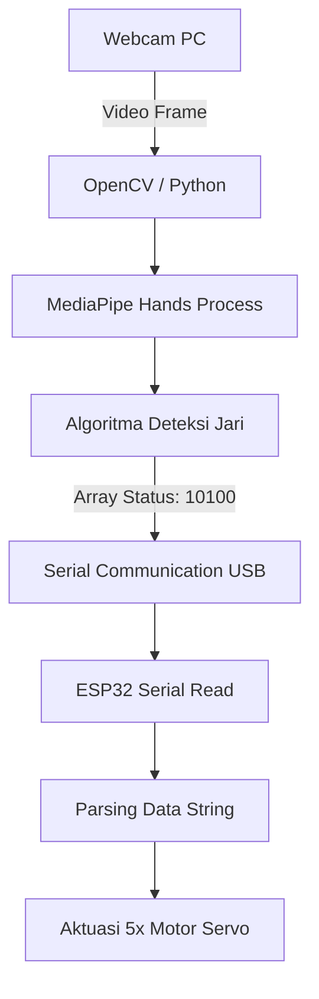

# 🖐️ Real-Time Hand Tracking & Gesture Control System

Sistem kendali berbasis *Computer Vision* menggunakan **Python**, **OpenCV**, dan **MediaPipe** untuk melacak koordinat sendi tangan (*hand landmarks*) secara real-time. Data status jari diterjemahkan menjadi sinyal biner dan dikirimkan secara serial ke mikrokontroler **ESP32** untuk menggerakkan 5 motor servo secara dinamis.

## 🧠 System Architecture & Features

Sistem ini terbagi menjadi dua sisi utama: pemrosesan visi komputer di sisi komputer (*Host*) dan eksekusi aktuator di sisi mikrokontroler (*Device*).

- **Real-Time Hand Landmark Detection**: Memanfaatkan model MediaPipe Hands untuk mendeteksi hingga 21 titik koordinat sendi tangan dengan tingkat akurasi tinggi.
- **Finger State Classification**: Algoritma pemindaian posisi relatif ujung jari terhadap ruas jari (*knuckles*) untuk menentukan status jari terbuka (`1`) atau tertutup (`0`).
- **Serial Data Streaming**: Mengirimkan array status biner 5-digit (contoh: `10100`) secara terus-menerus melalui komunikasi serial UART (baud rate 115200).
- **Dynamic Servo Actuation**: ESP32 membaca data serial yang masuk dan menyesuaikan posisi sudut setiap motor servo secara independen.

## 📌 Hardware & Pin Configuration

| Komponen | Pin ESP32 / Keterangan |
|---|---|
| Servo 1 (Thumb / Jempol) | Pin 12 |
| Servo 2 (Index / Telunjuk) | Pin 13 |
| Servo 3 (Middle / Tengah) | Pin 14 |
| Servo 4 (Ring / Manis) | Pin 15 |
| Servo 5 (Pinky / Kelingking) | Pin 16 |
| Komunikasi Serial | UART (TX/RX via kabel USB, Baud Rate: 115200) |

## 🔄 System Data Flow



## 💻 Software Stack & Dependencies

**Python (Host Side)**

- `OpenCV` (`cv2`) - Pengambilan frame kamera dan rendering UI
- `MediaPipe` (`mediapipe`) - Deteksi kerangka tangan (*hand tracking*)
- `PySerial` (`serial`) - Komunikasi data serial ke mikrokontroler

**C++ / Arduino (Device Side)**

- `ESP32Servo` - Pengendalian sinyal PWM motor servo
- Arduino IDE / PlatformIO Core

## 🚀 Getting Started

### 1. Sisi Mikrokontroler (ESP32)

1. Unggah (*upload*) kode C++ (`721.ino` / bagian firmware) ke ESP32.
2. Pastikan pin motor servo terhubung sesuai array `pinServo[] = {12, 13, 14, 15, 16}`.

### 2. Sisi Komputer (Python)

1. Pasang pustaka yang dibutuhkan:

   ```bash
   pip install opencv-python mediapipe pyserial
   ```

2. Sesuaikan port serial pada skrip Python dengan port ESP32 (contoh: `COM3`):

   ```python
   arduino = serial.Serial("COM3", 115200)
   ```

3. Jalankan skrip Python:

   ```bash
   python 721.py
   ```

4. Arahkan tangan ke depan webcam. Status bukaan jari akan terdeteksi dan menggerakkan servo secara langsung.